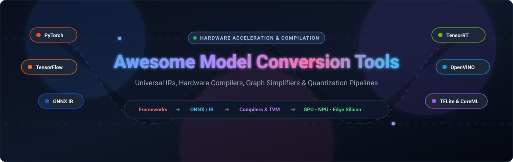
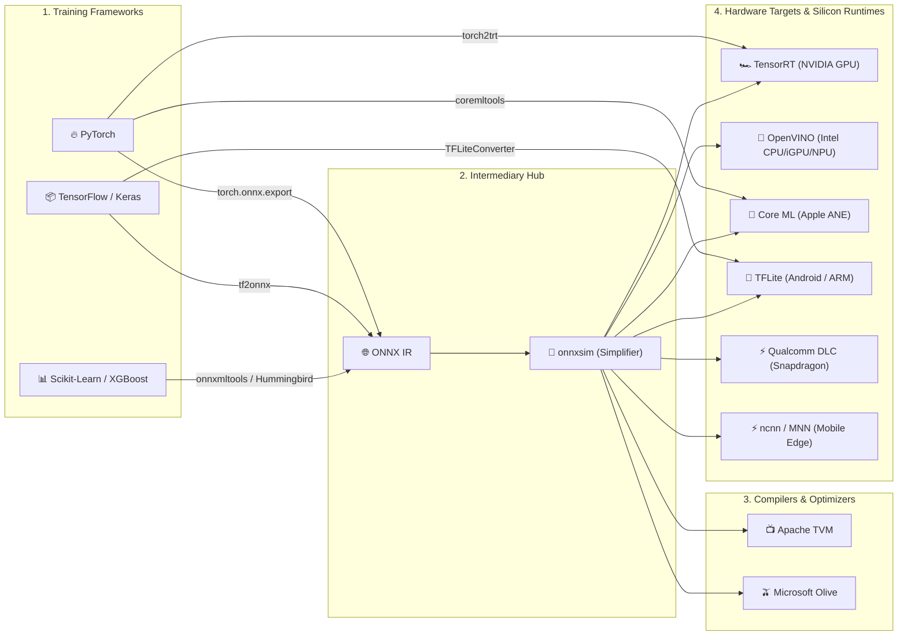

  

# 🚀 Awesome Model Conversion Tools

  
  
  
  
  

> ⚡ **A curated directory of SaaS platforms, compilers, transpilers, and open-source frameworks for Deep Learning Model Conversion, Quantization, Graph Simplification, and Hardware-Specific Inference Acceleration.**

---

## 📖 Table of Contents

- [🌟 Overview](#-overview)
- [🌐 Sector Overview & Market Dynamics](#-sector-overview--market-dynamics)
- [🏢 SaaS & Managed Conversion Platforms](#-saas--managed-conversion-platforms)
- [🛠️ Open-Source GitHub Projects](#️-open-source-github-projects)
- [🔄 Common Model Conversion Pathways](#-common-model-conversion-pathways)
- [🤝 How to Contribute](#-how-to-contribute)
- [💖 Support](#-support)
- [⭐ Star History](#-star-history)
- [⚠️ Disclaimer](#️-disclaimer)

---

## 🌟 Overview

Training a state-of-the-art neural network or machine learning model in **PyTorch**, **TensorFlow**, or **JAX** is only half the battle. Delivering sub-millisecond inference in production requires compiling, converting, and quantizing that model to fit target execution environments — including **NVIDIA GPUs (TensorRT)**, **Intel CPUs/iGPUs/NPUs (OpenVINO)**, **Apple Neural Engine (Core ML)**, **Qualcomm Snapdragon NPUs (QNN/DLC)**, **Android & Microcontrollers (TFLite)**, and **Embedded Edge Devices (ncnn, MNN, TVM)**.

This repository tracks top-tier tools that decouple the training environment from downstream serving runtimes, enabling zero-overhead execution across heterogeneous hardware.

---

## 🌐 Sector Overview & Market Dynamics

- 📊 **Market Sizing & Exponential Growth**: The global AI model optimization and compiler toolchain market is valued at approximately **$4.0 Billion in 2025** and is projected to surge past **$43.6 Billion by 2030**, reflecting a compounding annual growth rate (**CAGR of ~41.3%**). This meteoric acceleration is propelled by soaring hyperscaler inference costs and the massive migration toward on-device Edge AI and local LLM execution.
- 🧩 **Market Dynamics & Structural Fragmentation**: The sector operates as a **moderately fragmented yet hardware-polarized ecosystem**. While primary semiconductor juggernauts (*NVIDIA*, *Apple*, *Intel*, and *Qualcomm*) preserve proprietary, near-monopolistic vendor stacks (*TensorRT*, *Core ML*, *OpenVINO*, *Qualcomm QNN*) optimized exclusively for their respective silicon architectures, the intermediate layer is fiercely safeguarded by cross-platform open standards (*ONNX*) and universal compiler fabrics (*Apache TVM*). Consequently, a total single-vendor "winner-take-all" outcome is structurally checked by multi-cloud and cross-silicon enterprise deployment realities.

---

## 🏢 SaaS & Managed Conversion Platforms

The following hosted and cloud-native platforms automate model conversion, hardware profiling, quantization, and edge deployment pipelines. Entries are sorted in descending order by **Company Valuation / Market Capitalization**.

| 🏷️ Platform | 🏢 Provider & Valuation / Size | 🎯 Description & Hardware Scope | 💳 Specific Starting Price | 🎁 Free Tier Limits |
| :--- | :--- | :--- | :--- | :--- |
| **[NVIDIA AI Enterprise & NIM](https://build.nvidia.com)** | **NVIDIA Corporation** 📊 *Valuation: ~$3.4 Trillion* *(Annual Rev: ~$120B+)* | Enterprise inference microservices (NIM) and model compiler suites optimized for NVIDIA CUDA/TensorRT hardware architectures. | **$1.00 per GPU-hour** (consumption on AWS, Azure, GCP marketplaces) or **$4,500 per GPU/year** for on-premise self-managed annual license. | **Free forever for dev & prototyping** on up to 16 GPUs (self-hosted); hosted cloud API catalog (`build.nvidia.com`) includes **1,000 free credits/month** (capped at 40 RPM); **90-day free trial** for production evaluation. |
| **[AWS SageMaker Neo](https://aws.amazon.com/sagemaker/neo/)** | **Amazon Web Services (Amazon.com)** 📊 *Valuation: ~$2.1 Trillion* *(Annual Rev: ~$600B+)* | Managed machine learning compiler that automatically converts models to run up to 2x faster on Intel, NVIDIA, ARM, Qualcomm, and Ambarella targets. | **$0.00 dedicated compilation fee**; billing applies only to underlying compute instances used during compilation, starting at **$0.0464 per hour** for `ml.t3.medium` instances. | **2-Month Free Trial** under AWS Free Tier: **250 hours/month** of `ml.t3.medium` Studio notebooks, **50 hours/month** of `m4.xlarge`/`m5.xlarge` compilation/training jobs, and **125 hours/month** of real-time inference. |
| **[Qualcomm AI Hub](https://aihub.qualcomm.com/)** | **Qualcomm Technologies, Inc.** 📊 *Valuation: ~$185 Billion* *(Annual Rev: ~$39B)* | Web-based AI Model Optimizer (AIMO) and device farm for converting, quantizing, and compiling models into TFLite, ONNX, and DLC formats for Snapdragon NPUs. | **$0.00 / month** (Completely free cloud developer platform; monetized via downstream Qualcomm silicon purchases). | **Free forever with Qualcomm ID**: Unlimited model optimization, automated FP16/INT8 quantization, and live interactive profiling on real cloud-hosted Snapdragon devices without upfront hardware purchases. |
| **[Edge Impulse](https://edgeimpulse.com/)** | **Edge Impulse, Inc.** 📊 *Valuation: ~$250M – $350M* *(Total Funding: ~$85M)* | End-to-end development platform for edge ML, sensor data, computer vision, and TinyML with built-in hardware-aware model conversion to C++ and WebAssembly. | **$400 / month** for historical Pro tier / custom quote for Enterprise production deployment. | **Free Forever Developer Plan**: Includes **3 private projects**, **unlimited public projects**, **3 collaborators per project**, **60 minutes compute time per training/job**, **16 GB CPU RAM**, and **10 impulse experiments per project** with full GPU access. |
| **[NetsPresso](https://netspresso.ai/)** | **Nota AI (Nota Inc.)** 📊 *Valuation: ~$120M – $150M* *(Total Funding: ~$30M)* | Hardware-aware AI model compression and conversion SaaS that automatically prunes, quantizes, and translates models to TensorRT, OpenVINO, TFLite, and CoreML. | **$39 / month** (Starting Starter/Pro tier subscription) with scaling enterprise volume tiers. | **Free Forever Community Plan**: Full access to PyNetsPresso SDK, Model Searcher, and Compression Studio with up to **5 automated compression and conversion jobs per month** across standard cloud target devices. |

---

## 🛠️ Open-Source GitHub Projects

The premier open-source conversion libraries, transpilers, intermediate representations, and inference graph compilers. Entries are strictly sorted in descending order by **GitHub Star Count**.

1. ### 📦 [TensorFlow Lite Converter (tensorflow/tensorflow)](https://github.com/tensorflow/tensorflow) 
   - **Focus**: The official model conversion pipeline translating TensorFlow, Keras, and SavedModel graphs into `.tflite` format.
   - **Highlights**: Features comprehensive post-training quantization (PTQ: dynamic range, full integer INT8, float16) and micro-controller kernels (TFLite Micro).
   - **License**: Apache 2.0

2. ### ⚡ [ncnn (Tencent/ncnn)](https://github.com/Tencent/ncnn) 
   - **Focus**: High-performance neural network inference framework optimized specifically for mobile platforms, featuring converters for ONNX, Caffe, and Darknet.
   - **Highlights**: Zero third-party dependencies, fine-tuned ARM NEON assembly optimizations, Vulkan GPU acceleration, and dedicated `onnx2ncnn` transpiler tools.
   - **License**: BSD 3-Clause

3. ### 🚀 [ONNX Runtime (microsoft/onnxruntime)](https://github.com/microsoft/onnxruntime) 
   - **Focus**: Cross-platform, high-performance ML inference and training accelerator engine with built-in graph optimization and transformer conversion utilities.
   - **Highlights**: Pluggable Execution Providers (DirectML, TensorRT, OpenVINO, CoreML, CUDA), offline graph optimizations, and INT8/FP8 quantization tools.
   - **License**: MIT

4. ### 🌐 [ONNX (onnx/onnx)](https://github.com/onnx/onnx) 
   - **Focus**: The universal open standard and intermediate representation (IR) format for machine learning interoperability across training and inference ecosystems.
   - **Highlights**: The central interchange hub connecting PyTorch, TensorFlow, Scikit-Learn, MXNet, TensorRT, OpenVINO, Core ML, and hardware compilers worldwide.
   - **License**: Apache 2.0

5. ### 📱 [MNN (alibaba/MNN)](https://github.com/alibaba/MNN) 
   - **Focus**: Universal deep learning compiler and lightweight inference engine with built-in multi-framework model converters (`MNNConverter`).
   - **Highlights**: Translates ONNX, TensorFlow, TFLite, Caffe, and TorchScript models into optimized MNN computational graphs with quantization and winograd convolution support.
   - **License**: Apache 2.0

6. ### 📺 [Apache TVM (apache/tvm)](https://github.com/apache/tvm) 
   - **Focus**: Open-source machine learning compiler framework for CPUs, GPUs, and specialized hardware accelerators.
   - **Highlights**: Compiles models directly from ONNX, PyTorch, and TensorFlow into bare-metal binary code using machine-learning-driven auto-tuning (AutoTVM/MetaSchedule).
   - **License**: Apache 2.0

7. ### 🏎️ [TensorRT (NVIDIA/TensorRT)](https://github.com/NVIDIA/TensorRT) 
   - **Focus**: NVIDIA's premier software development kit for high-performance deep learning inference compilation on NVIDIA GPUs.
   - **Highlights**: Includes the open-source `trtexec` CLI and parsers to compile ONNX networks into highly fused, precision-calibrated (INT8, FP16, FP8) GPU execution plans.
   - **License**: Apache 2.0

8. ### 🧩 [OpenVINO Toolkit (openvinotoolkit/openvino)](https://github.com/openvinotoolkit/openvino) 
   - **Focus**: Intel's comprehensive open-source toolkit for optimizing and deploying deep learning models across Intel CPUs, iGPUs, and NPUs.
   - **Highlights**: Features the `ovc` (OpenVINO Converter) CLI to convert ONNX, TensorFlow, PyTorch, and PaddlePaddle models into Intermediate Representation (`.xml` + `.bin`).
   - **License**: Apache 2.0

9. ### 🍏 [Core ML Tools (apple/coremltools)](https://github.com/apple/coremltools) 
   - **Focus**: Apple's unified Python conversion package to convert trained models from PyTorch and TensorFlow into Apple Core ML (`.mlpackage`) format.
   - **Highlights**: Direct PyTorch-to-CoreML unified converter, automatic partition execution targeting Apple Neural Engine (ANE), and post-training compression/quantization.
   - **License**: BSD 3-Clause

10. ### 🔀 [torch2trt (NVIDIA-AI-IOT/torch2trt)](https://github.com/NVIDIA-AI-IOT/torch2trt) 
    - **Focus**: PyTorch-to-TensorRT converter utilizing TensorRT Python APIs for fast, direct PyTorch model acceleration without manual ONNX export steps.
    - **Highlights**: Allows in-place conversion of PyTorch `nn.Module` models with direct fallback to PyTorch operations when unsupported layers appear.
    - **License**: Apache 2.0

11. ### 🦁 [PINTO Model Zoo (PINTO0309/PINTO_model_zoo)](https://github.com/PINTO0309/PINTO_model_zoo) 
    - **Focus**: Extensive repository containing conversion scripts, shell pipelines, and post-quantized models across TensorFlow, ONNX, OpenVINO, TFLite, and Myriad.
    - **Highlights**: Indispensable real-world reference for handling edge cases, dynamic shape resolution, and cross-framework layer discrepancies.
    - **License**: MIT

12. ### 🧹 [onnxsim / ONNX Simplifier (daquexian/onnx-simplifier)](https://github.com/daquexian/onnx-simplifier) 
    - **Focus**: Graph simplification tool that eliminates redundant operations in exported ONNX computational graphs.
    - **Highlights**: Executes constant folding, dead-code pruning, and shape inference to produce clean, simplified models ready for downstream compilation in TensorRT or OpenVINO.
    - **License**: Apache 2.0

13. ### 🐦 [Hummingbird (microsoft/hummingbird)](https://github.com/microsoft/hummingbird) 
    - **Focus**: Compiles traditional machine learning algorithms (Scikit-Learn, LightGBM, XGBoost) into tensor computations.
    - **Highlights**: Transpiles decision trees and linear models into PyTorch, TorchScript, ONNX, or TVM tensors to leverage GPU acceleration and neural network execution pipelines.
    - **License**: MIT

14. ### 🔗 [ONNX-TensorRT (onnx/onnx-tensorrt)](https://github.com/onnx/onnx-tensorrt) 
    - **Focus**: The official open-source ONNX parser repository utilized by NVIDIA TensorRT.
    - **Highlights**: Programmatically parses ONNX computational graphs directly into TensorRT network definitions for custom C++ and Python inference engines.
    - **License**: Apache 2.0

15. ### 🔄 [tf2onnx (onnx/tensorflow-onnx)](https://github.com/onnx/tensorflow-onnx) 
    - **Focus**: Robust converter transpiling TensorFlow (1.x and 2.x), Keras, SavedModel, and TFLite files directly to the ONNX graph format.
    - **Highlights**: Maintains deep operator mappings, supporting complex control-flow operations and frozen graphs.
    - **License**: Apache 2.0

16. ### 🫒 [Olive (microsoft/Olive)](https://github.com/microsoft/Olive) 
    - **Focus**: Microsoft's extensible, hardware-aware model conversion and optimization pipeline framework.
    - **Highlights**: Automates model composition, pruning, INT4/INT8 quantization, ONNX export, and tuning across target accelerators (DirectML, QNN, OpenVINO, TensorRT).
    - **License**: MIT

17. ### 🌲 [onnxmltools (onnx/onnxmltools)](https://github.com/onnx/onnxmltools) 
    - **Focus**: Transpiles models from Scikit-Learn, LightGBM, XGBoost, CoreML, and LibSVM into the ONNX standard.
    - **Highlights**: Enables classical tabular models to be exported into intermediate representation formats for standardized serving via ONNX Runtime.
    - **License**: Apache 2.0

18. ### 🛶 [Paddle2ONNX (PaddlePaddle/Paddle2ONNX)](https://github.com/PaddlePaddle/Paddle2ONNX) 
    - **Focus**: Model conversion tool that exports PaddlePaddle framework models to ONNX format.
    - **Highlights**: Supports over 200+ PaddlePaddle models spanning vision, OCR, speech, and NLP into standardized ONNX architectures.
    - **License**: Apache 2.0

19. ### 🌳 [Treelite (dmlc/treelite)](https://github.com/dmlc/treelite) 
    - **Focus**: Universal model compiler specifically engineered for tree ensembles (XGBoost, LightGBM, Scikit-learn).
    - **Highlights**: Translates tree models into self-contained, optimized C code, minimizing decision tree evaluation latency to bare-metal speeds.
    - **License**: Apache 2.0

20. ### 🔁 [openvino2tensorflow (PINTO0309/openvino2tensorflow)](https://github.com/PINTO0309/openvino2tensorflow) 
    - **Focus**: Reverse conversion utility that converts OpenVINO Intermediate Representation (IR) graphs back into TensorFlow, TFLite, and TFJS formats.
    - **Highlights**: Critical for cross-ecosystem porting when upstream training source code is missing or proprietary.
    - **License**: MIT

---

## 🔄 Common Model Conversion Pathways

---

## 🤝 How to Contribute

We actively welcome contributions to expand this directory! To add a new open-source converter or SaaS platform:

1. 🍴 **Fork this repository**.
2. 📝 **Add or edit entries in `README.md`**:
   - For **SaaS platforms**, ensure the entry is placed in the table with verified starting prices, specific free tier limits, and valuation/revenue.
   - For **Open-Source projects**, add the social badge `` and place it in the correct star-sorted position.
3. 🧪 **Preserve alphabetical or star-based sorting rules**.
4. 🚀 **Submit a Pull Request** with a succinct description of the tooling addition.

---

## 💖 Support

If this compilation saves you hours of debugging cross-framework compilation issues:

- ⭐ **Star this repository** on GitHub to amplify its visibility.
- 🍴 **Fork the repo** to keep a personal bookmark.
- 📢 **Share with fellow ML & MLOps engineers** deploying edge and cloud models.
- ☕ **Support continuous maintenance & updates** via the [GitHub Sponsors Dashboard](https://github.com/sponsors/ishandutta2007).

---

## ⭐ Star History

---

## ⚠️ Disclaimer

- This curated list is maintained for educational and operational engineering guidance. Mentions of commercial SaaS platforms or open-source repositories do not constitute formal endorsements.
- **Conversion Preprocessing Caveat**: Model conversion tools cannot rectify mismatched pre-processing steps. Always verify RGB vs. BGR channel ordering, normalization factors (mean/standard deviation), and NHWC vs. NCHW tensor layout before compiling.
- **Quantization Verification**: INT8 or FP16 post-training quantization can introduce numeric degradation or accuracy loss. Always benchmark precision against a baseline validation dataset.
